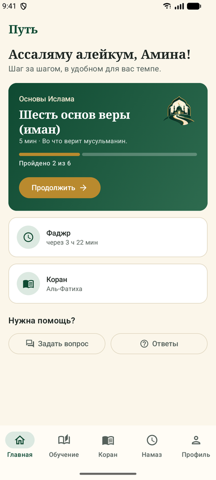
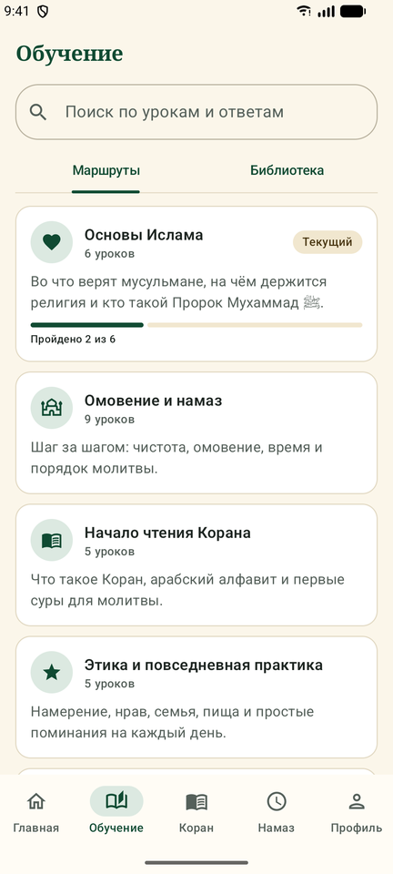
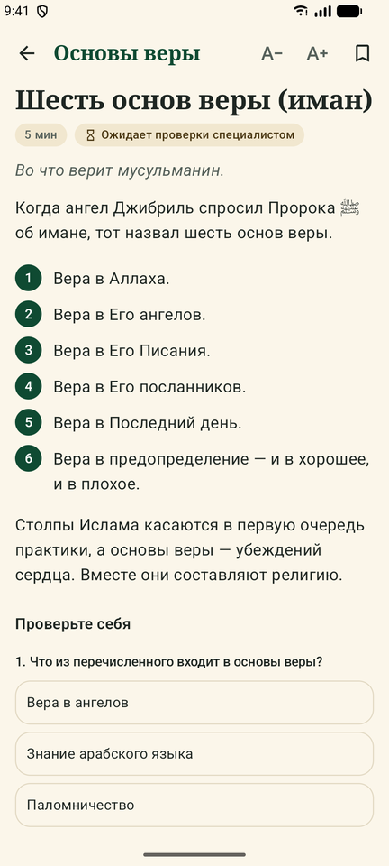
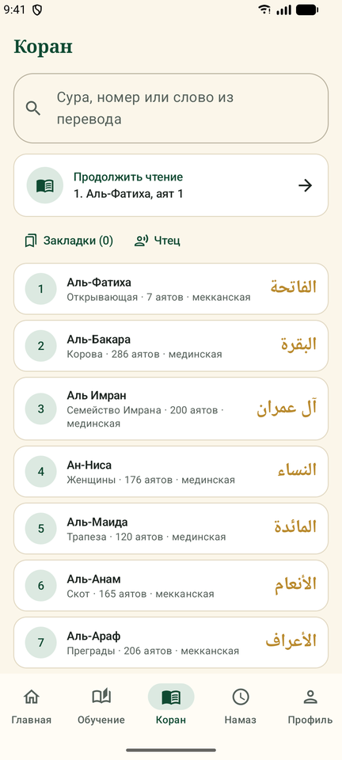
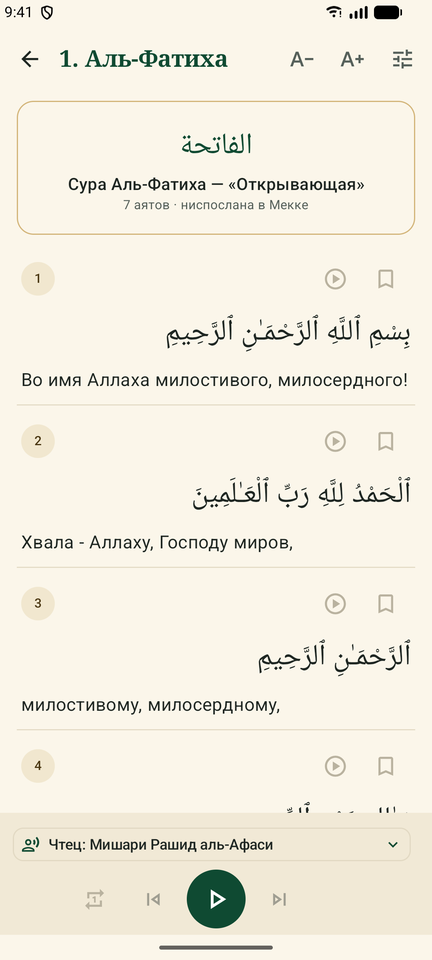
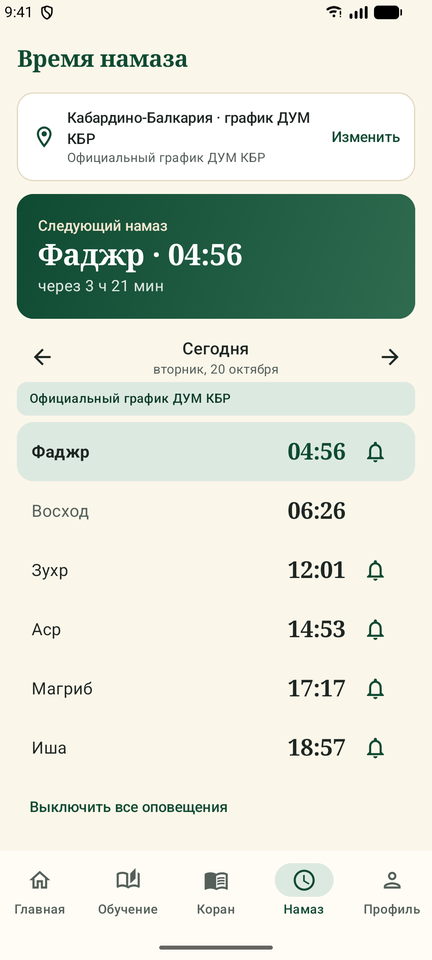
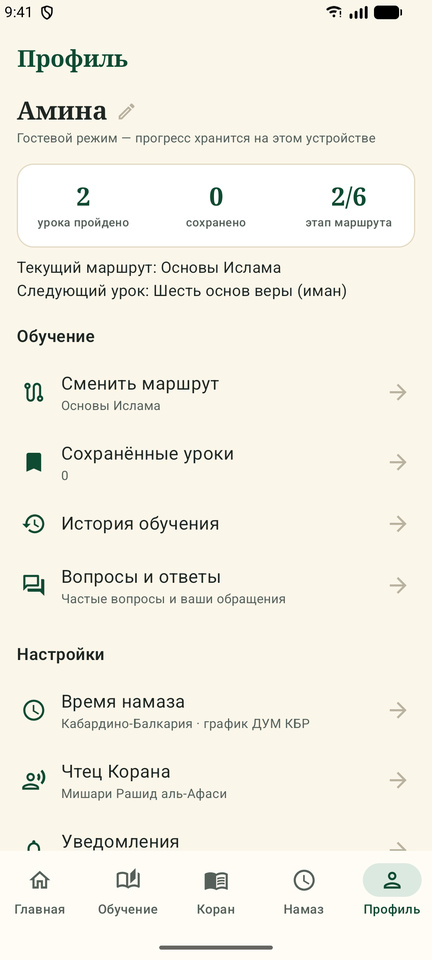
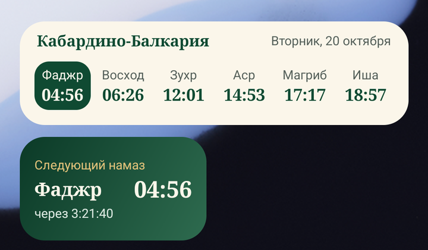

# Путь (MuslimPath)

Android-приложение для тех, кто начинает изучать Ислам: учебные маршруты, короткие уроки, Коран с переводом и аудио, время намаза с оповещениями и азаном, виджеты для рабочего стола, вопросы и ответы.
Нативный Kotlin + Jetpack Compose, интерфейс на русском языке. Серверная часть — Supabase (PostgreSQL + RLS).

## Возможности

- **Главный экран** — приветствие по имени, следующий урок маршрута с прогрессом, ближайший намаз и сколько до него осталось, сура, на которой вы остановились, быстрый вопрос.
- **Обучение** — 5 маршрутов от простого к сложному, 27 коротких уроков с источниками, статусом проверки и мини-тестом, поиск, закладки, история.
- **Коран** — арабский текст, перевод смыслов Крачковского, аудио по аятам (14 чтецов), закладки, продолжение чтения с того же аята.
- **Время намаза** — официальный график ДУМ КБР или расчёт для любого города, оповещения, азан, виджеты на рабочий стол.
- **Вопросы и ответы** — частые вопросы и форма своего вопроса.
- **Профиль** — имя (можно изменить), прогресс, настройки, удаление всех данных. Работает без регистрации; аккаунт нужен только для синхронизации.

## Скриншоты

| Главная | Обучение | Урок | Коран |
|:---:|:---:|:---:|:---:|
|  |  |  |  |

| Сура | Время намаза | Профиль |
|:---:|:---:|:---:|
|  |  |  |

**Виджеты на рабочем столе** — «Намаз на сегодня» (4×1) и «Следующий намаз» (2×1):



## Структура

```
app/                         Android-приложение
  src/main/assets/content.json   Учебный контент: 5 маршрутов, 9 категорий, 27 уроков, FAQ
  src/main/assets/quran/         Арабский текст, перевод Крачковского, список сур
  src/main/assets/prayer/        Официальное расписание намазов ДУМ КБР (kbr-YYYY.json)
  src/main/assets/adhan/         Запись азана (adhan.mp3, при наличии adhan_fajr.mp3)
  src/main/java/.../data/        Модели, загрузка контента, Коран и аудио, время намаза, локальное хранилище, клиент Supabase
  src/main/java/.../ui/          Экраны (Compose) и тема в цветах логотипа
  src/main/java/.../notifications/  Оповещения о намазе (AlarmManager), азан (foreground-служба) и мягкие напоминания (WorkManager)
  src/main/java/.../widgets/     Виджеты времени намаза (RemoteViews)
  src/test/                      Юнит-тесты расчёта времени намаза
supabase/migrations/         Схема БД, роли, RLS, журнал изменений, RPC
tools/                       Вспомогательные скрипты (Python)
docs/screenshots/            Скриншоты для README
store-description.md         Тексты для Google Play / RuStore
```

## Сборка

Нужны Android SDK (platform 37) и любой JDK 17+ для запуска Gradle. JDK 17 для компиляции Gradle скачает сам (toolchains).

```bash
./gradlew assembleDebug
```

APK появится в `app/build/outputs/apk/debug/app-debug.apk`. minSdk 26 (Android 8.0), targetSdk 37.

Тесты:

```bash
./gradlew testDebugUnitTest
```

## Подключение сервера (необязательно)

Без настроек приложение полностью работает офлайн, в гостевом режиме. Чтобы включить отправку вопросов и синхронизацию:

1. Создайте проект Supabase, включите **Anonymous sign-ins** (Authentication → Providers).
2. Примените миграцию: `supabase db push` (или выполните `supabase/migrations/*.sql` в SQL-редакторе).
3. Добавьте в `local.properties`:
   ```
   supabase.url=https://<project>.supabase.co
   supabase.anonKey=<anon key>
   ```

Гость получает анонимную сессию при первом обращении; «Создать аккаунт» привязывает e-mail и пароль к тому же пользователю, и прогресс сохраняется.

## Контент и религиозная проверка

Все уроки и ответы в `content.json` — **черновики редакции со статусом «Ожидает проверки специалистом»**. По ТЗ (п. 3.3, 8, 11.11) до публикации их должен проверить квалифицированный специалист. После проверки в поле `review` указываются `status: "verified"`, `reviewer`, `date`, `editor`. В БД триггер не даёт опубликовать материал без одобрения проверяющим, причём проверяющий не может быть автором материала.

Тексты политики конфиденциальности и соглашения (`DocScreen.kt`) — черновики, их нужно согласовать с юристом.

## Коран

- Арабский текст — Tanzil Project (tanzil.net), CC BY 3.0. Файл `assets/quran/quran-uthmani.txt` хранится без изменений, вместе с блоком копирайта.
- Перевод смыслов — И. Ю. Крачковский (общественное достояние), электронный текст Tanzil.net.
- Аудио — потоковое чтение по аятам с EveryAyah.com, 14 чтецов (в том числе медленное чтение аль-Хусари для обучения). Прослушанные аяты кэшируются на устройстве (до 300 МБ).
- Новый перевод (например, Кулиева после получения разрешения) добавляется одной записью в `QuranRepository.translations` и файлом в формате Tanzil `сура|аят|текст`.

## Время намаза

- Для Кабардино-Балкарии — официальное расписание Духовного управления мусульман КБР. Годовой PDF с kbrdum.ru переводится в `assets/prayer/kbr-YYYY.json` скриптом `tools/parse_kbr.py`; дни, которых нет в файле (например, следующий год до обновления приложения), раз в сутки подгружаются с сайта.
- Для остальных городов — астрономический расчёт (библиотека Adhan), 10 методов на выбор.
- Оповещения: планируется только ближайшее событие, после срабатывания ставится следующее. Для каждого включённого намаза это напоминание заранее (за 5–30 мин, если выбрано) и/или сигнал в момент наступления времени. Будильники восстанавливаются после перезагрузки, смены времени или часового пояса и обновления приложения.

### Что дальше

- Веб-панель администратора (уроки, проверка, вопросы пользователей, статистика через `admin_stats()`).
- Загрузка контента с сервера через `content_bundle()` с кэшем на устройстве.
- Push-уведомления через FCM об ответах и новых материалах.
- Аудио к урокам.
